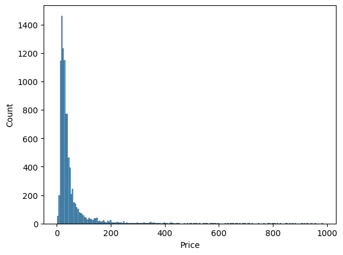
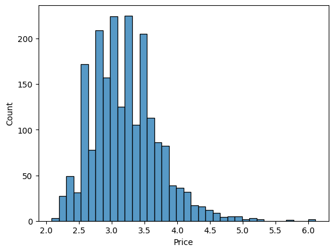

# Applying Linear Models on Higher Dimensional Data

Trying different Linear Models on a very high dimensional dataset and trying different preprocessign techniques to achieve a better model with reduced errors and higher accuracy.

## 21st Century Bordeaux Wine Dataset

**Source** : [21st Century Bordeaux Wine Dataset , Kaggle](https://www.kaggle.com/datasets/mexwell/21st-century-bordeaux-wine-dataset)

It contains 14,349 rows and 987 column which is considerd as a so called high dimensional datset.

### Preprocessing Involves

*   Dropping the Duplicate Columns[No Duplicate found].
*   Removing $ from the `Price` column, and filling the NaN values uing ***KNN Imputer***.

But KNN Imputer is not performing better here as when we drop the columns it works much better.

## Scenario 1

When Dropping the NaN rows & using Elastic Net Regression ```ElasticNet(alpha=0.02 , l1_ratio=0.9)```


**:Results**

```
Mean Squared Error : 4403.104543845137
Mean Absolute Error : 32.2357908740841
R2 Score : 0.26519259366362147
```

## Scenario 2

\
*FIGURE 1 : Here the target column is highly right skwed with a skwness value of `7.72`*

Let's apply the log transformation on the target column `Price` in order to reduce skwness.


*FIGURE 2 : Here the target column is slightly right skwed with a skwness value of `0.87`*

After applying `np.log1p()` to the target column.

**:Results**
```
Mean Squared Error : 0.2275876453530767
Mean Absolute Error : 0.3742066200769175
R2 Score : 0.1872660863196831
```

Here we can clearly see that applying log transformation is not giving good results in generall.