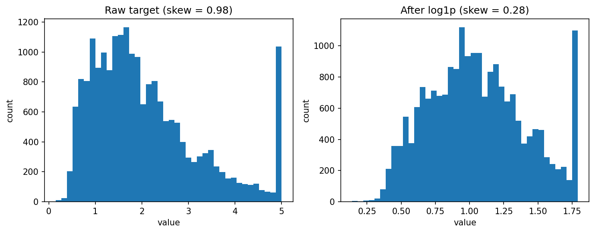
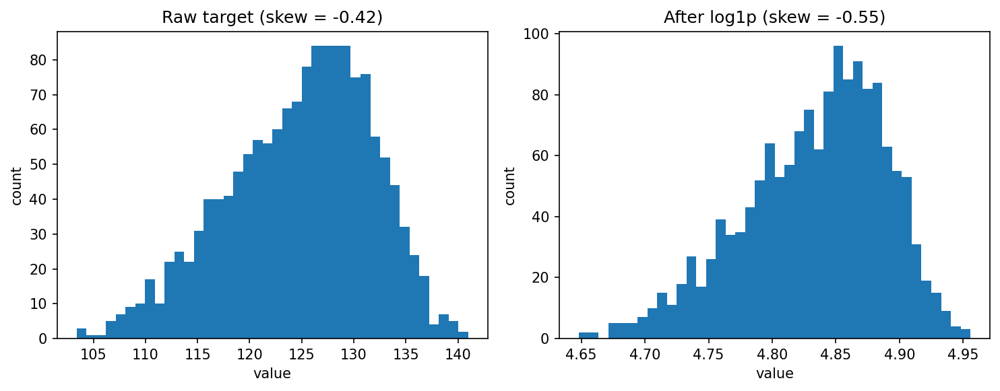
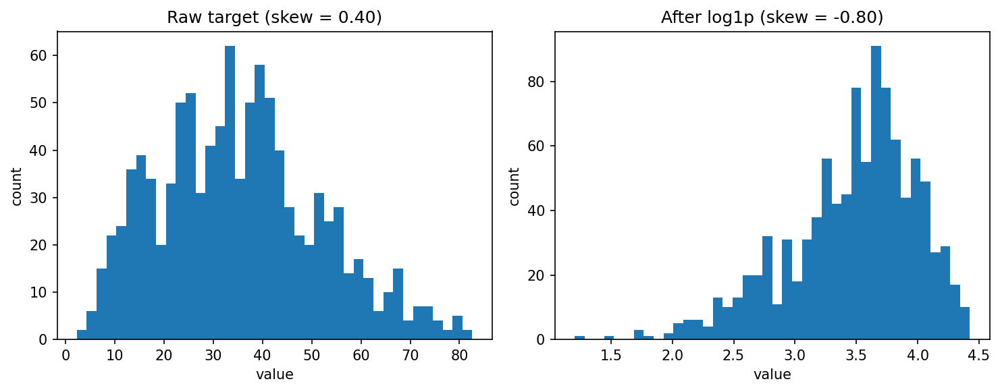
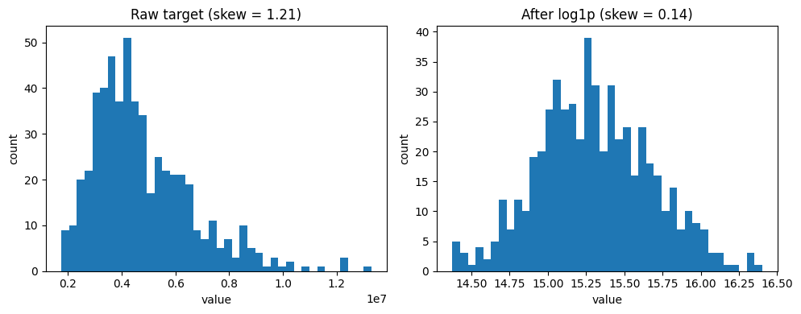

# Does log-transforming the target improve a linear regression model? A small comparison

**Hypothesis** :- If a dataset has a few very large target values(skewed dataset), taking the log of the target should help a linear regression predict better, because those few big values will no longer dominate the fit. If the target is already balanced, I expect no real difference.

## What is a skewed target??

*Figure 1: Histogram illustrating the right-skewed distribution of the target variable (medical insurance charges) across the dataset.*

Lets talk about right-skewed target the left skewed idea is also the same. A target is right-skewed when most values are small and a few are very large, so the histogram has a long tail on the right. Insurance charges are an example: most people pay a few thousand, but a few pay much more. In the above pair of images you can see how a right-skewed graph is now became a close to normally distributed graph after the log transformation `ln(1+𝑥)`.

## Definition of _“better”_

As we get lower MAE , RMSE and higher R² score this could be a better model and can be our goal. This generally indicate higher prediction accuracy and smaller errors. Error is measured on unseen data **_(Error is measured on 20 random [80/20] train/test splits)_** and on the original, untransformed target, so that all models are compared in the same units.

## Universal Preprocessing before Prediction

**For Model B**: I added a safeguard that clips/clamps the log predictions(execute after the model predicts its values) to the absolute minimum and maximum log charges present in the training data respectively: `np.clip(pred_b_log, min_log_val, max_log_val)`. This prevents exponential reconstruction explosions(too much higher values) when executing `np.expm1()` on the predictions.

**For Model A**: Raw predictions are clamped to the minimum and maximum raw target values seen in the training data respectively: `[y_train.min(), y_train.max()]` AS `np.clip(pred_a_raw, min_raw_val, max_raw_val)`

## Medical Insurance Costs Dataset

___

**Name and Source** :- [Medical Insurance Cost Prediction, Kaggle](https://www.kaggle.com/datasets/rahulvyasm/medical-insurance-cost-prediction)

**Dataset Details** :- The dataset comprises 1338 rows (after dropping the duplicate values) and 7 columns, including:

-   `Age`: Primary beneficiary's age (18 to 64)
-   `Sex`: Gender of the beneficiary (male / female)
-   `BMI`: Body mass index (weight in kg / height in meters squared) 
-   `Children`: Number of children / dependents covered 
-   `Smoker`: Smoking status (yes / no) 
-   `Region`: Residential area in the US (southwest, southeast, northwest, northeast)
-   `Charges`: Individual medical costs billed by health insurance

Here, `Charges` is the target/output column, and rest is the input columns.

### Preprocessing (identical for both models):- 

| Column | Type | Treatment |
|---|---|---|
| Age | numeric | no changes |
| BMI | numeric | no changes |
| Children | numeric | no changes |
| Sex | categorical (2 values) | encoded as 0/1 |
| Smoker | categorical (2 values) | encoded as 0/1 |
| Region | categorical (4 values) | one-hot encoded |
| Charges | target/numeric | Model A: raw. Model B: `log1p`, then `expm1` on predictions |

### Additional preprocessing
1.  **Duplicate Removal**: We dropped duplicate entries (`.drop_duplicates()`) to prevent identical rows from appearing in both train and test splits.
2.  **Logical Boundary Validation**: We filtered out logically impossible values, specifically ensuring `age > 0` and `charges > 0` (in target column). This removes corrupt placeholder data before it reaches the model.

### Medical Insurance Costs: results

**Setup:** 20 random 80/20 train/test splits (seeds 0–19). Both models are scored on the original (untransformed) target. \
**Target skewness:** `1.51` before the log, `-0.09` after.

| Model | R² (mean ± std) | RMSE (mean ± std) | MAE (mean ± std) |
| --- | --- | --- | --- |
| A: raw target | 0.741 ± 0.032 | 6,066 ± 465 | 4,204 ± 261 |
| B: log target | 0.533 ± 0.071 | 8,117 ± 587 | 4,182 ± 391 |

*± is the standard deviation across the 20 splits: how much the score typically changes from one split to another.*

**Finding:** On this dataset, my hypothesis was not supported. Log-transforming the target made predictions worse on the original scale for R² and RMSE. MAE was slightly lower for the log model, but the gap was small compared with the variation across splits.

**Each Seeds results**: [results/med-insurance_predictions.csv](results/med-insurance_predictions.csv)

## Diamonds Dataset

___

**Name & Source** :- [Diamonds Dataset, Seaborn](https://github.com/mwaskom/seaborn-data/blob/master/diamonds.csv)

**Dataset Details** :- The Seaborn diamonds dataset contains 53,940 rows and 10 columns detailing the prices and physical attributes of round-cut diamonds.

-   `price`: Price in US dollars ($326 to $18,823)
-   `carat`: Weight of the diamond (0.2 to 5.01)
-   `cut`: Quality of the cut (*Fair, Good, Very Good, Premium, Ideal*)
-   `color`: Diamond color, from *J* (worst) to *D* (best)
-   `clarity`: Measurement of clarity (*I1* [worst] to *IF* [best])
-   `depth`: Total depth percentage (`2 * z / (x + y)`), ranging from 43% to 79%
-   `table`: Width of the top of the diamond relative to widest point (43 to 95)
-   `x`, `y`, `z`: Length, width, and depth in mm

### Target Variable Distribution

*Figure 2: Histogram illustrating the right-skewed distribution of the target variable (diamond datset prices) across the dataset.*

### Preprocessing (identical for both models):- 

| Column | Type | Treatment |
|---|---|---|
| carat | numeric | no changes |
| depth | numeric | no changes |
| table | numeric | no changes |
| x | numeric | no changes |
| y | numeric | no changes |
| z | numeric | no changes |
| cut | categorical (ordinal - 5 values) | mapped to sequential integers (Fair=0 to Ideal=4) |
| color | categorical (ordinal - 7 values) | mapped to sequential integers (J=0 to D=6) |
| clarity | categorical (ordinal - 8 values) | mapped to sequential integers (I1=0 to IF=7) |
| price | target/numeric | Model A: raw. Model B: `log1p`, then `expm1` on predictions |

### Additional Preprocessing
1.  **Data Cleaning (Before training the model ,Removing Typos):** I removed the physical impossibility records (where dimensions `y` or `z` are larger than 20mm for small diamonds). This is standard practice in data science because keeping obvious typos in your test set corrupts performance evaluations.

### Diamonds Dataset : results
**Setup:** 20 random 80/20 train/test splits (seeds 0-19). Both models are scored on the original (untransformed) target. \
**Target skewness:** `1.62` before the log, `0.12` after.

| Model | R² (mean ± std) | RMSE (mean ± std) | MAE (mean ± std) |
| --- | --- | --- | --- |
| A: raw target | 0.921 ± 0.002 | 1,114 ± 16 | 715 ± 7 |
| B: log target | 0.953 ± 0.001 | 859 ± 13 | 456 ± 4 |

*± is the standard deviation across the 20 splits: how much the score typically changes from one split to another.*

**Finding**: Model B's is perfroming better on every metric especially MAE and slightly better on R² ,RMSE now the Model B here is performing quit well. So, here on this current dataset and setup i can say result is consistent with my hypothesis by a small margin.

**Each Seeds results**: [results/diamondDS_predictions_robust.csv](results/diamondDS_predictions_robust.csv)

## California Housing Dataset

**Name & Source** :- [fetch_california_housing from Scikit-Learn](https://scikit-learn.org/stable/modules/generated/sklearn.datasets.fetch_california_housing.html)

**Dataset Details** :- This datasets contains 20,640rows and 9columns(8 input and 1 target) derived from the 1990 U.S. Census for California.

-   `MedInc`: Median income in the block group
-   `HouseAge`: Median house age in the block group
-   `AveRooms`: Average number of rooms per household
-   `AveBedrms`: Average number of bedrooms per household
-   `Population`: Block group population
-   `AveOccup`: Average house occupancy (number of household members)
-   `Latitude`: House block latitude
-   `Longitude`: House block longitude
-   `MedHouseVal`: Median house value for California districts, expressed in hundreds of thousands of dollars ($100,000) (target/ output column)

### Target Variable Distribution

*Figure 3: Histogram illustrating the medium right skeweness of the target variable (california housing dataset) and a extreame outlier*

### Preprocessing (identical for both models):- 
Here, for this dataset their is no need for any preprocessing. Dropped duplicates just as a standard sanity check and applied clips/claps to bothe Model A & Model B.

### California Housing Dataset : results
**Setup:** 20 random 80/20 train/test splits (seeds 0-19). Both models are scored on the original (untransformed) target. \
**Target skewness:** `0.98` before the log, `0.28` after. 

| Model | R² (mean &plusmn; std) | RMSE (mean &plusmn; std) | MAE (mean &plusmn; std) |
| --- | --- | --- | --- |
| A: raw target | 0.618 &plusmn; 0.008 | 0.713 &plusmn; 0.008 | 0.522 &plusmn; 0.005 |
| B: log target | 0.615 &plusmn; 0.008 | 0.716 &plusmn; 0.010 | 0.497 &plusmn; 0.006 |

*± is the standard deviation across the 20 splits: how much the score typically changes from one split to another.*

**Finding:** On this dataset both the models were close. Model A was slightly ahead on R² and RMSE, but the gaps were smaller than the variation across splits, so I treat them as tied. Model B had a clearly lower MAE (0.497 vs 0.522). The target has moderate skew (0.98), so this dataset does not clearly test either side of the hypothesis.

**Each Seeds results**: [results/calif-housingDS_predictions_robust.csv](results/calif-housingDS_predictions_robust.csv)

## Airfoil Self-Noise Dataset

**Name & Source** :- [Airfoil Self-Noise Dataset, UCI](https://archive.ics.uci.edu/dataset/291/airfoil+self+noise)

**Dataset Details** :- It has 1,503 rows and 6 attributes/columns (5 input features, 1 target variable) derived from NASA wind tunnel tests.

- `Frequency`: f (in Hertz, Hz)
- `Angle of Attack`: α (in degrees, °)
- `Chord Length`: c (in meters, m)
- `Free-stream Velocity`: in meters per second, m/s
- `Suction Side Displacement Thickness`: δ (in meters, m)
- `Scaled Sound Pressure Level`: SPL (in decibels, dB) (Output / Target Column)

### Target Variable Distribution

*Figure 4: Histogram illustrating that the target here isn’t right-skewed. It’s mildly left-skewed `−0.41`, and the log made it slightly more skewed `−0.54`.*

### Preprocessing (identical for both models):-

Here, for this dataset their is no need for any preprocessing as all the columns are numerical. Dropped duplicates just as a standard sanity check[but no duplicate found] and applied clips/claps to both Model A & Model B.

### Airfoil Self-Noise Dataset : results

**Setup:** 20 random 80/20 train/test splits (seeds 0-19). Both models are scored on the original (untransformed) target. **Target skewness:** `-0.41` before the log, `-0.54` after.

| Model | R² (mean ± std) | RMSE (mean ± std) | MAE (mean ± std) |
| --- | --- | --- | --- |
| A: raw target | 0.497 ± 0.043 | 4.837 ± 0.248 | 3.746 ± 0.166 |
| B: log target | 0.488 ± 0.044 | 4.877 ± 0.247 | 3.769 ± 0.165 |

*± is the standard deviation across the 20 splits: how much the score typically changes from one split to another.*

**Finding**: On this dataset both the models were close. Model A was slightly ahead on each parameter, but the gaps were far smaller. The results are consistent with the second half of the hypothesis(If the target is already balanced, I expect no real difference).

**Each Seeds results**: [results/airfoilDS_predictions_robust.csv](results/airfoilDS_predictions_robust.csv)

## Concrete Compressive Strength Dataset

**Name & Source** :- [Concrete Compressive Strength, UCI](https://archive.ics.uci.edu/dataset/165/concrete+compressive+strength)

**Dataset Details** :- It has 1030 rows and 9 attributes/columns (8 input features, 1 target variable).

### Features Units & Details

| Column Name (In Dataset) | Variable Description | Data Type | Measurement Unit |
| :--- | :--- | :--- | :--- |
| **cement** | Cement component quantity in the mix | float | $\text{kg/m}^3$ |
| **slag** | Blast furnace slag component quantity | float | $\text{kg/m}^3$ |
| **ash** | Fly ash component quantity in the mix | float | $\text{kg/m}^3$ |
| **water** | Water component quantity in the mix | float | $\text{kg/m}^3$ |
| **superplastic** | Superplasticizer additive quantity | float | $\text{kg/m}^3$ |
| **coarseagg** | Coarse aggregate component quantity | float | $\text{kg/m}^3$ |
| **fineagg** | Fine aggregate component quantity | float | $\text{kg/m}^3$ |
| **age** | Age of the concrete before testing | float | Days |
| **strength** | **[Target Variable]** Measured compressive strength | float | $\text{MPa}$ |

### Target Variable Distribution

*Figure 5: Histogram illustrating the little right skeweness of the target variable (concrete compressive strength dataset) but after applying log it shows a left skewed graph.*

### Preprocessing (identical for both models):-

Here, for this dataset their is no need for any preprocessing as all the columns are flaot/numerical. Dropped duplicates just as a standard sanity check[25 duplicated found] and applied clips/claps to both Model A & Model B.

### Concrete Compressive Strength Dataset : results

**Setup:** 20 random 80/20 train/test splits (seeds 0-19). Both models are scored on the original (untransformed) target. **Target skewness:** `0.40` before the log, `-0.81` after.

| Model | R² (mean ± std) | RMSE (mean ± std) | MAE (mean ± std) |
| --- | --- | --- | --- |
| A: raw target | 0.598 ± 0.035 | 10.225 ± 0.430 | 8.124 ± 0.338 |
| B: log target | 0.495 ± 0.052 | 11.459 ± 0.563 | 9.031 ± 0.419 |

*± is the standard deviation across the 20 splits: how much the score typically changes from one split to another.*

**Finding**: Here, clearly Model A is performing better than B in every metric. We applied log despite the target is already close to normal. So, here in this case the log is not contributing rather it is make things even worse.

**Each Seeds results**: [results/concrete_strength_predictions_robust.csv](results/concrete_strength_predictions_robust.csv)

## Housing Prices Dataset

**Name & Source** :- [Housing Prices Dataset, Kaggle](https://www.kaggle.com/datasets/yasserh/housing-prices-dataset)

**Dataset Details** :- It contains 545 samples with 13 features(12 INPUT + 1 TARGET COLUMN).

### Features Units & Details

| Column Name | Data Type | Description |
| :--- | :--- | :--- |
| **`price`** | Float | **The Target Variable.** The final sale price of the house. |
| **`area`** | Float | Total plot or floor area of the house (typically in square feet). |
| **`bedrooms`** | Int | Total number of bedrooms (1 to 6+). |
| **`bathrooms`** | Int | Total number of bathrooms. |
| **`stories`** | Int | Number of levels/floors the house has (e.g., 1, 2, 3, 4). |
| **`mainroad`** | Categorical (Binary) | Is the house connected/facing a main road? (yes / no). |
| **`guestroom`** | Categorical (Binary) | Does the house have a dedicated guest room? (yes / no). |
| **`basement`** | Categorical (Binary) | Does the house have a basement? (yes / no). |
| **`hotwaterheating`** | Categorical (Binary) | Does the house feature hot water central heating? (yes / no). |
| **`airconditioning`** | Categorical (Binary) | Does the house have an A/C system installed? (yes / no). |
| **`parking`** | Int | Number of dedicated car parking spaces available (0 to 3). |
| **`prefarea`** | Categorical (Binary) | Is the house located in a preferred/premium neighborhood? (yes / no). |
| **`furnishingstatus`** | Categorical (Nominal) | The interior status: furnished, semi-furnished, or unfurnished. |

### Target Variable Distribution

*Figure 6: Histogram illustrating the right skeweness of the target variable (housing prices dataset) but after applying log it gets close to normally distributed.*

### Preprocessing (identical for both models):-

| Column | Type | Treatment |
| --- | --- | --- |
| area | numeric | no changes |
| bedrooms | numeric | no changes |
| bathrooms | numeric | no changes |
| stories | numeric | no changes |
| parking | numeric | no changes |
| mainroad | categorical (2 values) | encoded as 0/1 |
| guestroom | categorical (2 values) | encoded as 0/1 |
| basement | categorical (2 values) | encoded as 0/1 |
| hotwaterheating | categorical (2 values) | encoded as 0/1 |
| airconditioning | categorical (2 values) | encoded as 0/1 |
| prefarea | categorical (2 values) | encoded as 0/1 |
| furnishingstatus | categorical (3 values) | one-hot encoded |
| price | target/numeric | Model A: raw. Model B: `log1p`, then `expm1` on predictions |

### Housing Dataset : results

**Setup:** 20 random 80/20 train/test splits (seeds 0-19). Both models are scored on the original (untransformed) target. **Target skewness:** `1.17` before the log, `0.13` after.

| Model | R² (mean ± std) | RMSE (mean ± std) | MAE (mean ± std) |
| --- | --- | --- | --- |
| A: raw target | 0.652 ± 0.037 | 1,089,414 ± 119,685 | 798,663 ± 67,657 |
| B: log target | 0.665 ± 0.054 | 1,067,224 ± 126,055 | 766,818 ± 74,769 |

*± is the standard deviation across the 20 splits: how much the score typically changes from one split to another.*

**Finding**: On this dataset both the models were close. Model B was slightly ahead on each parameter, but the gaps were too small. The results are consistent with the second half of the hypothesis(If the target is already balanced, I expect no real difference).

**Each Seeds results**: [results/housing_predictions_robust.csv](results/housing_predictions_robust.csv)
