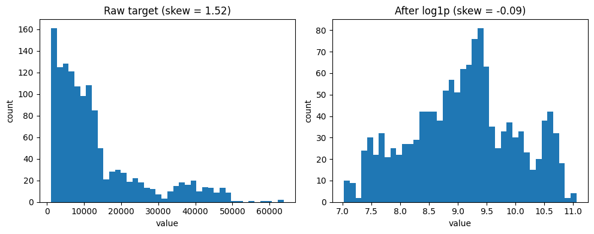
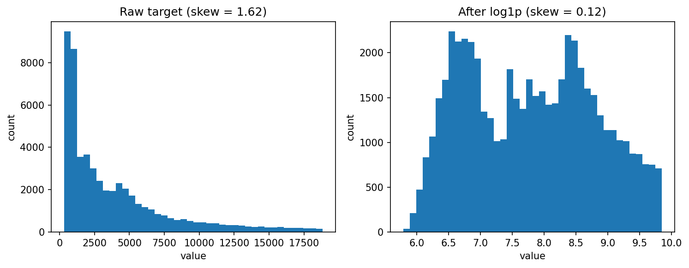

# Does log-transforming the target improve a linear regression model? A small comparison

**Hypothesis** :- If a dataset has a few very large target values(skewed dataset), taking the log of the target should help a linear regression predict better, because those few big values will no longer dominate the fit. If the target is already balanced, I expect no real difference.

## What is a skewed target??

*Figure 1: Histogram illustrating the right-skewed distribution of the target variable (medical insurance charges) across the dataset.*

Lets talk about right-skewed target the left skewed idea is also the same. A target is right-skewed when most values are small and a few are very large, so the histogram has a long tail on the right. Insurance charges are an example: most people pay a few thousand, but a few pay much more. In the above pair of images you can see how a right-skewed graph is now became a close to normally distributed graph after the log transformation `ln(1+𝑥)`.

## Definition of _“better”_

As we get lower MAE , RMSE this could be a better model and can be our goal. This generally indicate higher prediction accuracy and smaller errors. Error is measured on unseen data **_(Error is measured on 20 random [80/20] train/test splits)_** and on the original, untransformed target, so that all models are compared in the same units.

## Universal Preprocessing

I added a safeguard that clips/clamps the log predictions(execute after the model predicts its values) to the absolute minimum and maximum log charges present in the training data respectively: `np.clip(pred_b_log, min_log_val, max_log_val)`. This prevents exponential reconstruction explosions(too much higher values) when executing `np.expm1()` on the predictions.

## Medical Insurance Costs Dataset

___

**Name and Source** :- [Medical Insurance Cost Prediction, Kaggle](https://www.kaggle.com/datasets/rahulvyasm/medical-insurance-cost-prediction)

**Dataset Details** :- The dataset comprises 1338 rows (after dropping the duplicate values) and 7 columns, including:

-   `Age`: Primary beneficiary's age (18 to 64)
-   `Sex`: Gender of the beneficiary (male / female)
-   `BMI`: Body mass index (weight in kg / height in meters squared) 
-   `Children`: Number of children / dependents covered 
-   `Smoker`: Smoking status (yes / no) 
-   `Region`: Residential area in the US (southwest, southeast, northwest, northeast)
-   `Charges`: Individual medical costs billed by health insurance

Here, `Charges` is the target/output column, and rest is the input columns.

### Preprocessing (identical for both models):- 

| Column | Type | Treatment |
|---|---|---|
| Age | numeric | no changes |
| BMI | numeric | no changes |
| Children | numeric | no changes |
| Sex | categorical (2 values) | encoded as 0/1 |
| Smoker | categorical (2 values) | encoded as 0/1 |
| Region | categorical (4 values) | one-hot encoded |
| Charges | target/numeric | Model A: raw. Model B: `log1p`, then `expm1` on predictions |

### Additional preprocessing
1.  **Duplicate Removal**: We dropped duplicate entries (`.drop_duplicates()`) to prevent identical rows from appearing in both train and test splits.
2.  **Logical Boundary Validation**: We filtered out logically impossible values, specifically ensuring `age > 0` and `charges > 0` (your target column). This removes corrupt placeholder data before it reaches the model.

### Medical Insurance Costs: results

**Setup:** 20 random 80/20 train/test splits (seeds 0–19). Both models are scored on the original (untransformed) target. \
**Target skewness:** `1.51` before the log, `-0.09` after.

| Model | R² (mean ± std) | RMSE (mean ± std) | MAE (mean ± std) |
| --- | --- | --- | --- |
| A: raw target | 0.739 ± 0.031 | 6,083 ± 460 | 4,246 ± 257 |
| B: log target | 0.533 ± 0.071 | 8,117 ± 587 | 4,182 ± 391 |

*± is the standard deviation across the 20 splits: how much the score typically changes from one split to another.*

**Finding:** On this dataset, my hypothesis was not supported. Log-transforming the target made predictions worse on the original scale for R² and RMSE. MAE was slightly lower for the log model, but the gap was small compared with the variation across splits.

**Each Seeds results**: [results/med-insurance_predictions.csv](results/med-insurance_predictions.csv)

## Diamonds Dataset

___

**Name & Source** :- [Diamonds Dataset, Seaborn](https://github.com/mwaskom/seaborn-data/blob/master/diamonds.csv)

**Dataset Details** :- The Seaborn diamonds dataset contains 53,940 rows and 10 columns detailing the prices and physical attributes of round-cut diamonds.

-   `price`: Price in US dollars ($326 to $18,823)
-   `carat`: Weight of the diamond (0.2 to 5.01)
-   `cut`: Quality of the cut (*Fair, Good, Very Good, Premium, Ideal*)
-   `color`: Diamond color, from *J* (worst) to *D* (best)
-   `clarity`: Measurement of clarity (*I1* [worst] to *IF* [best])
-   `depth`: Total depth percentage (`2 * z / (x + y)`), ranging from 43% to 79%
-   `table`: Width of the top of the diamond relative to widest point (43 to 95)
-   `x`, `y`, `z`: Length, width, and depth in mm

### Target Variable Distribution

*Figure 2: Histogram illustrating the right-skewed distribution of the target variable (diamond datset prices) across the dataset.*

### Preprocessing (identical for both models):- 

| Column | Type | Treatment |
|---|---|---|
| carat | numeric | no changes |
| depth | numeric | no changes |
| table | numeric | no changes |
| x | numeric | no changes |
| y | numeric | no changes |
| z | numeric | no changes |
| cut | categorical (ordinal - 5 values) | mapped to sequential integers (Fair=0 to Ideal=4) |
| color | categorical (ordinal - 7 values) | mapped to sequential integers (J=0 to D=6) |
| clarity | categorical (ordinal - 8 values) | mapped to sequential integers (I1=0 to IF=7) |
| price | target/numeric | Model A: raw. Model B: `log1p`, then `expm1` on predictions |

### Additional Preprocessing
1.  **Data Cleaning (Before training the model ,Removing Typos):** I removed the physical impossibility records (where dimensions `y` or `z` are larger than 20mm for small diamonds). This is standard practice in data science because keeping obvious typos in your test set corrupts performance evaluations.

### Diamonds Dataset : results
**Setup:** 20 random 80/20 train/test splits (seeds 0--19). Both models are scored on the original (untransformed) target. \
**Target skewness:** `1.62` before the log, `0.12` after.

| Model | R² (mean ± std) | RMSE (mean ± std) | MAE (mean ± std) |
| --- | --- | --- | --- |
| A: raw target | 0.908 ± 0.002 | 1,201 ± 18 | 800 ± 7 |
| B: log target | 0.953 ± 0.001 | 859 ± 13 | 456 ± 4 |

*± is the standard deviation across the 20 splits: how much the score typically changes from one split to another.*

**Finding**: Model B's initial results are affected by extreme predictions(there are extreame outliers in the dataset) after performing some additional preprocessing (you can check above), now the Model B here is performing quit well. So, here on this current dataset and setup i can say my hypothesis is correct.

**Each Seeds results**: [results/diamondDS_predictions_robust.csv](results/diamondDS_predictions_robust.csv)